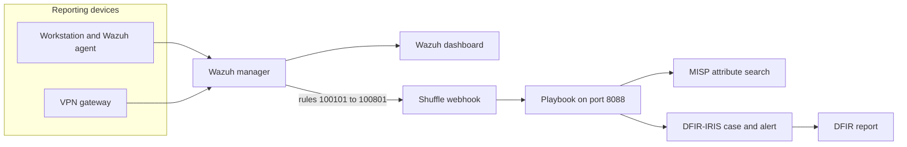

# 4. Architecture



The workstation reports interactive logons and file events. The VPN gateway reports VPN failures and successes. Both arrive as one log shape:

```text
dfir-lab: action=login result=success user=alice srcip=198.51.100.20 country=BR service=ssh sha256=- path=-
```

Wazuh decodes that line, applies `wazuh/rules/dfir-lab-rules.xml`, and shows the alert on its dashboard. The integration file `wazuh/integration/shuffle.xml` forwards only the eight use-case rule ids. Shuffle posts the alert JSON to the playbook. The playbook searches MISP, then creates the IRIS case `DFIR-<rule id>-<user>` and an IRIS alert that keeps the original Wazuh JSON. The DFIR report is written from that case.

Defensive actions stay with the analyst. The case text tells them what to do. Shuffle does not perform it.

| Rule | Recommended action recorded on the case |
|---|---|
| 100101 | Contact the user out of band. Revoke the newer session if they do not recognize it. |
| 100202 | Reset the password and review the successful session. |
| 100301 | Treat the successful address as untrusted until the user confirms it. |
| 100401 | Review the VPN profile and the new source with the user. |
| 100501 | Ask whether travel was expected. |
| 100601, 100701, 100801 | State that the hash is the EICAR test file. Remove the copy if the test was not approved. |
